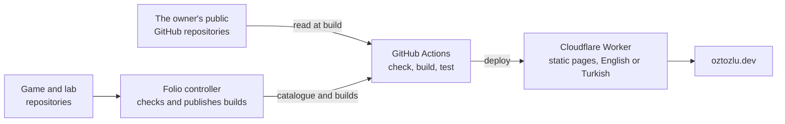

# Folio

The personal site of İzzet Can Öztozlu, at [oztozlu.dev](https://oztozlu.dev): projects read from GitHub, games and interactive experiments that run in the page, and a CV, in English and Turkish, with four colour skins.

[](https://github.com/Contraill/Folio/actions/workflows/production.yml)

## How it works



- Every page is static, built ahead of time with [Astro](https://astro.build), with React for the interactive parts. One Cloudflare Worker serves the build and picks English or Turkish for each visitor; there is no database and no server-side rendering.
- Every public repository of the owner is a project, with no file or tag needed in the repository. Pinned repositories lead the home page. A sync rebuilds the site when GitHub changes, and skips the build when nothing did.
- Games (`/play`) and experiments (`/lab`) are built in their own repositories, from public templates, and served by Folio itself.

## Running it

Requires Node 26 (`.node-version`) and pnpm 12.

```sh
pnpm install
pnpm dev        # development server
pnpm build      # GitHub data, static build, route list
pnpm preview    # the build behind the language Worker, at http://localhost:4321
pnpm check      # types and Astro diagnostics
pnpm test       # unit tests
pnpm test:e2e   # browser tests against the local build
```

Without a `GITHUB_TOKEN`, the build uses the recorded GitHub data and two stand-in apps in `tests/fixtures`, so it works offline.

## Layout

```text
src/
  pages/        Routes, each built in English and Turkish ([...locale])
  layouts/      Page shell
  components/   Astro components and React islands
  content/      Page copy and project write-ups, their schemas, and the rules that pick projects from GitHub
  lib/          Motion, notched panels, client state, routing, the language Worker's logic
  i18n/         Language negotiation and interface strings
  styles/       Design system and the four skins
  worker.ts     The language Worker
scripts/        GitHub data before the build, route list and /_build.json after it, release and post-deploy checks
public/         Fonts, images, the CV PDFs
tests/          Browser tests, the recorded GitHub data and stand-in apps
.github/        CI, Preview and Production workflows
docs/           Technical documentation
```

## Documentation

- [Architecture](docs/architecture.md): how the parts work together, and the limits accepted on purpose
- [Content model](docs/content-model.md): where everything the site says comes from
- [Deployment](docs/deployment.md): workflows, secrets, tests, releasing and rolling back

Games, experiments and separate sites are made from three public templates, each with its own README: [folio-play-template](https://github.com/Contraill/folio-play-template), [folio-lab-template](https://github.com/Contraill/folio-lab-template) and [folio-site-template](https://github.com/Contraill/folio-site-template). The controller that publishes them is private.

## Contributing

This is a personal site, so it doesn't take new features, but bug reports and fixes are welcome. Pull requests into `main` run the CI checks; runs for outside contributors wait for the owner's approval.

Please report a security problem privately, through *Security → Report a vulnerability* on this repository, not in an issue.

## Licence

The code is under the [MIT licence](LICENSE).

The licence doesn't cover the site's content, which remains all rights reserved: the portrait (`public/assets/portrait.webp`), the CV (`public/cv/`), the project images (`public/assets/`), the copy and write-ups (`src/content/pages/`, `src/content/projects/`), and the İC monogram, favicon and icons. Please don't reuse them as your own.

Third-party parts keep their own licences: the fonts Archivo, Geist, Geist Mono and Instrument Serif are self-hosted under the SIL Open Font License (`public/fonts/OFL.txt`), and the libraries in `package.json` under theirs (MIT, ISC and Apache-2.0).
