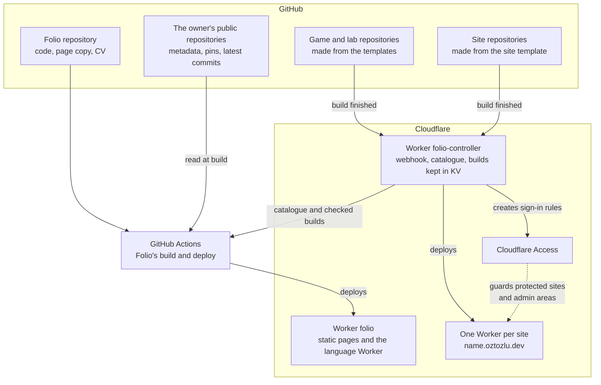
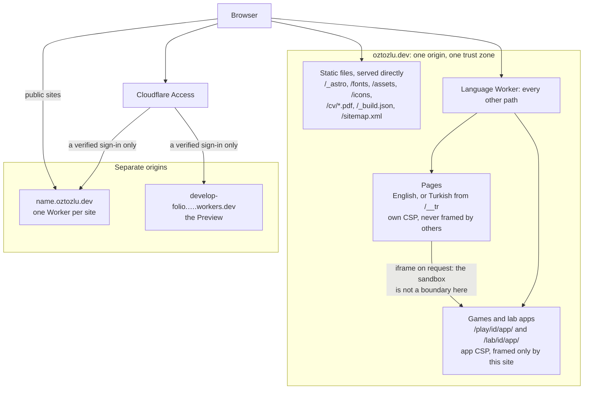
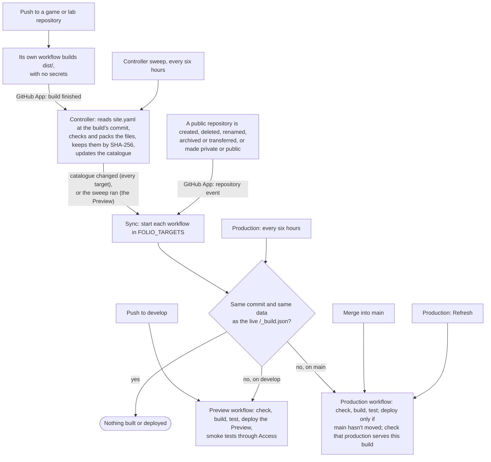

# Architecture

Folio is the personal site at [oztozlu.dev](https://oztozlu.dev). It is built ahead of time as static pages and served by one Cloudflare Worker, which also picks English or Turkish for each visitor. Every public GitHub repository of the owner is a project, read at build time. Games and lab experiments are built in their own repositories and served by Folio itself.

This document explains how the parts fit together and which limits are accepted on purpose. Commands, workflows and releases are covered in [deployment.md](deployment.md), and where each piece of content comes from in [content-model.md](content-model.md).

## The system

| Part | What it is |
| --- | --- |
| Folio repository | This repository: the site's code, its copy in English and Turkish, project write-ups, the CV PDFs and the workflows |
| GitHub data | Every public repository of the owner, the profile pins and each repository's latest commit, read by the build with the job's own token |
| Templates | `folio-play-template`, `folio-lab-template` and `folio-site-template`, public repositories that new games, experiments and sites are made from. Each has a `site.yaml` and a workflow that builds the repository with no secrets |
| Folio controller | A private repository with a GitHub App, a small Worker and a workflow. It publishes games, experiments and sites, and starts Folio's build when something Folio shows has changed. Its README is its operations manual |
| Worker `folio` | The built site plus the language Worker (`src/worker.ts`, logic in `src/lib/language-worker.ts`) |

Folio has no database, no server-side rendering and no admin: everything it shows is in Git or on GitHub, and a change reaches visitors only through a build.

Stack: Astro 7 (static output), TypeScript, React 19 islands, Cloudflare Workers with Static Assets, GitHub Actions.

## Pages

Every page is built twice: English at its address (`dist/about/index.html`) and Turkish under an internal prefix (`dist/__tr/about/index.html`). `src/pages/[...locale]/*.astro` own the routes and their data, `getStaticPaths` builds each one in both languages, and `src/middleware.ts` reads the language from the prefix at build. Static markup stays in Astro components; anything interactive is a React island.

- **Island props are public.** They are serialized into the HTML, so nothing private is ever passed to an island.
- **Browser APIs stay behind a guard** in anything an island imports, since islands also render at build.
- **The route list is not public.** `scripts/postbuild.ts` writes it to `.folio/routes.json`, which is bundled into the Worker; no file in `dist` lists the routes (a test checks).

## Requests and trust boundaries

`assets.run_worker_first` in `wrangler.jsonc` sends every request through the language Worker except a short list of static prefixes, so `/about/index.html` and any spelling of `/__tr/...` still meet it. The Worker:

- picks the language: `?lang=tr`, then the `lang` cookie the language buttons write, then `Accept-Language`, then English;
- answers any direct request for `/__tr/...`, after decoding, collapsing slashes and ignoring case, with the not-found page;
- sends `Content-Language`, `Vary: Cookie, Accept-Language`, `Cache-Control: private, max-age=60`, the security headers (`frame-ancestors 'none'`, `nosniff`, a referrer policy, a permissions policy) and `X-Robots-Tag: noindex` on unlisted pages;
- serves games and lab apps from their folders with the app policy (below).

Pages carry their Content Security Policy as a meta tag written by Astro: scripts only from the site itself plus SHA-256 hashes for the few inline ones, styles with `'unsafe-inline'` because components set CSS variables through style attributes, and `frame-src 'self'` so a page can frame only this site's own apps. `frame-ancestors` can't be set from a meta tag, which is why the Worker sends it as a header. The browser suite fails on any policy violation and checks that an injected script is blocked.

Astro's documentation lists `ClientRouter` as unsupported with `security.csp`. The combination works across navigations: the whole browser suite covers it in Chromium and Firefox, and its critical path in WebKit.

HTML is sent with `Cache-Control: private, max-age=60`: never kept by shared caches, and a published change reaches a visitor within a minute. That minute also lets the browser reuse pages that links prefetch on hover, focus or touch.

## Page transitions

The site keeps a persistent shell: the top bar stays, its indicator slides between items, the page content moves in a direction, and a project card's image grows into the project page. It uses Astro's `ClientRouter` (same-document transitions) rather than native cross-document view transitions, because Firefox doesn't support the latter (`pagereveal` is missing) and would lose them.

- `Base.astro` keeps the top bar island and `#overlays`, the container Radix portals render into, across navigations; without it, swapping the body would remove portal content React still owns.
- `src/lib/shell.ts` follows the router's lifecycle: it computes the direction from the menu order, carries the skin to the incoming document and reinstalls the reveal and tilt effects. `motion.css` holds the animations, through the `page`, `bar` and `media` transition names.
- Project filters change the address without a transition. `ProjectsBrowser` handles their history entries before the router, which would otherwise reload the page.
- A press during a transition ends it at once and the click is sent again to whatever is under the pointer, since animated elements can't be hit.
- A page left before React has taken over its islands unmounts them mid-hydration, which React reports as error 424 although nothing is wrong. A small patch to Astro's React renderer treats only that case as expected; see [deployment.md](deployment.md#tooling).
- Without JavaScript the site is an ordinary multi-page site.

## Design system

| File | Contents |
| --- | --- |
| `styles/reset.css` | Base reset |
| `styles/tokens.css` | The four skins (Graphite, Paper, Terminal, Blueprint) as custom properties |
| `styles/site.css`, `motion.css`, `pages.css` | Layout, components, motion and page-specific styles |
| `styles/ui.css` | Overlays: dialogs, sheets, popover, command palette |
| `styles/adaptations.css` | Adjustments to the base styles, including each skin's cursor, loaded last and kept in one place |

All pages share one stylesheet, about 18 KB compressed: splitting it would save little, and its rules depend on their order. The skin is applied before first paint by a small inline script (`src/lib/prepaint.ts`), allowed by its hash. Terminal and Blueprint are hidden skins, unlocked in a browser by finding `/now` and `/secret`. Custom cursors apply only to a fine pointer that can hover; touch devices keep their native behaviour. Motion follows `prefers-reduced-motion`.

## Languages

Addresses have no language prefix. Each page has one address, the same in both languages, and that address is its canonical URL: search engines index the English version, and there are no `hreflang` alternates. A Turkish visitor who follows a search result still gets Turkish.

Interface strings are in `src/i18n/messages.ts`. Every page group and every project written in Folio must have both languages: a missing Turkish file stops the build. Only text that comes from GitHub (a repository's description) may be English-only on a Turkish page, with a short note beside it.

## Keeping up with GitHub

Data is read at build, never while a visitor waits. `scripts/fetch-github.ts` reads the owner's public repositories, pins and latest commits with the job's own `GITHUB_TOKEN`, and the controller's catalogue with each app's build. Social preview images are downloaded and optimised at build, so nothing on a page points back at GitHub.

The controller starts a sync of Folio's workflows when its catalogue changes and at once when a public repository is created, deleted, renamed, archived or transferred, or a repository is made private or public; its six-hourly sweep syncs the Preview, whose branch can't have a schedule of its own. A sync reads GitHub first and compares a hash of the data, and the commit, with the live `/_build.json`: if both are the same, nothing is built. A repository made private therefore leaves the site within one build (a few minutes), and pins, descriptions and new commits appear within six hours. If a sync can't run, the live version stays as it was. Production checks every six hours on its own schedule, so it doesn't depend on the controller for that.

There is no faster way to remove something: the Worker doesn't look anything up per request. That is the accepted cost of a Worker with no state.

## Games, lab apps and sites

Games, lab experiments and separate sites live in their own repositories, made from the three templates. Each repository's workflow tests and builds it with no secrets and keeps `dist/` as an artifact. The controller's GitHub App reports each finished build to the controller, whose workflow never runs a repository's code: it reads `site.yaml` from the same commit as the build and checks the files. Only the owner's own repositories are published, never a fork, and only from a build that ran in that same repository.

**Sites** (`kind: site`) run behind their own Worker at `https://<name>.oztozlu.dev`: public, behind Cloudflare Access, or encrypted with a password, with an optional admin area guarded separately. They are separate deployments, and none of their content is in Folio's build. Their rules are in `folio-site-template`'s README.

**Games and lab apps** (`kind: play`, `kind: lab`) are part of Folio:

1. The controller packs a checked build, keeps it in KV by its SHA-256 and lists it in its catalogue with that hash. The catalogue and the builds answer only to a read token that Folio's Preview and Production builds hold, and are never cached.
2. Folio's build downloads the catalogue and each build, and keeps a build only if its hash and size match. A missing or wrong build is left out with a warning; an unreachable catalogue fails the build.
3. `scripts/postbuild.ts` checks every path and unpacks the builds into `/play/<id>/app/` and `/lab/<id>/app/`.
4. The language Worker serves those folders with the app policy: the app's own files only (no third-party requests), WebAssembly and Web Workers allowed, framed only by this site (`frame-ancestors 'self'`), `noindex`. `index.html` is never cached, files with a content hash in their name are cached for a year, and an address without an extension that isn't a file gets the app's page with a `<base>`, for single-page apps.
5. `/play/<id>` and `/lab/<id>` are Folio's pages for the app. They load it in a frame only when the visitor asks, with full screen and a plain link to open it in a new tab.

### Same origin, on purpose

The apps share Folio's origin, so the address stays `oztozlu.dev/play/…` and the Preview can test them exactly as production serves them. That has consequences, accepted for this release:

- **The iframe is not an isolation boundary.** The frame has a sandbox (`allow-scripts allow-same-origin allow-pointer-lock allow-downloads`, no pop-ups), but with the same origin an app's script can reach Folio's page, its storage and its cookies. Folio keeps nothing secret in the browser, only preferences such as the skin and the language.
- **A new tab has no sandbox at all.** Opening an app in its own tab runs it as a page of the site.
- **The hash proves where the files came from, not that they are safe.** It shows that Folio serves exactly the build the controller checked. The controller checks the build's shape (size, paths, no links, no Worker code), not what its code does.
- **Namespaced storage is organisation, not security.** The templates name every key and database after the app's place (`play:<id>:`, `lab:<id>:runs`), so apps don't overwrite each other by accident. Nothing stops one app from reading another's.
- **Dependencies are trusted code.** Whatever an app's build includes runs with Folio's origin.

That is acceptable only because every app is the owner's own repository, built by its own workflow and checked by the controller. Separate subdomains would isolate apps, at the cost of putting each one outside Folio's build and its Preview.

## Security model

- **Nothing to write to.** Folio has no database, admin or write endpoint: changing it takes a commit that passes the checks and a deploy.
- **Private content is not in this build.** Public and unlisted pages are part of it; anything private is a separate site behind Access or a password.
- **Visibility levels:**

  | Level | Address works | Menu, search, sitemap | Search engines |
  | --- | --- | --- | --- |
  | public | yes | yes | indexed |
  | unlisted (`/now`, `/secret`) | yes | no | `noindex` in the page and in `X-Robots-Tag` |
  | private | as a separate site, after sign-in | no | no |

- **GitHub data** is read with each job's own `GITHUB_TOKEN`, which expires with the job and can't see the owner's private repositories. Private repositories are dropped before anything is written or logged, and again when projects are chosen. Folio's own repository and the profile README repository are never projects.
- **Previews** sit behind Cloudflare Access. Production's `workers.dev` address is off, so production answers only on its domain.
- **Secrets** are GitHub environment secrets, each usable only from its own branch: a Cloudflare token that can edit the `folio` Worker and nothing else, the catalogue's read token, and the Access service token the Preview's tests use. None is in the repository or in a log. The controller's credentials are in the private controller repository and its Worker, never in Folio.
- **No analytics.** No analytics script, no tracking cookie; the policy would block a third-party beacon. The privacy page says what the site keeps in the browser and what Cloudflare logs.

## Environments

| | Local | Preview | Production |
| --- | --- | --- | --- |
| Address | `http://localhost:4321` | `develop-folio.<subdomain>.workers.dev`, behind Access | `oztozlu.dev` |
| Deployed by | `pnpm preview` (`wrangler dev`) | the Preview workflow, from `develop` | the Production workflow, from `main` |
| GitHub data | recorded snapshot in `tests/fixtures`, unless a token is set | live | live |
| Games and lab apps | recorded catalogue and builds in `tests/fixtures` | the controller's catalogue | the controller's catalogue |

## Known limits

- Play and Lab apps share Folio's origin (above).
- Removing a project or an app takes one build; there is no instant block.
- GitHub may delay or skip scheduled runs, so "every six hours" is a target.
- There are no `hreflang` alternates: search engines see the English version of each page.
- Safari and iOS have been tested only through WebKit in Playwright, not on real devices.
